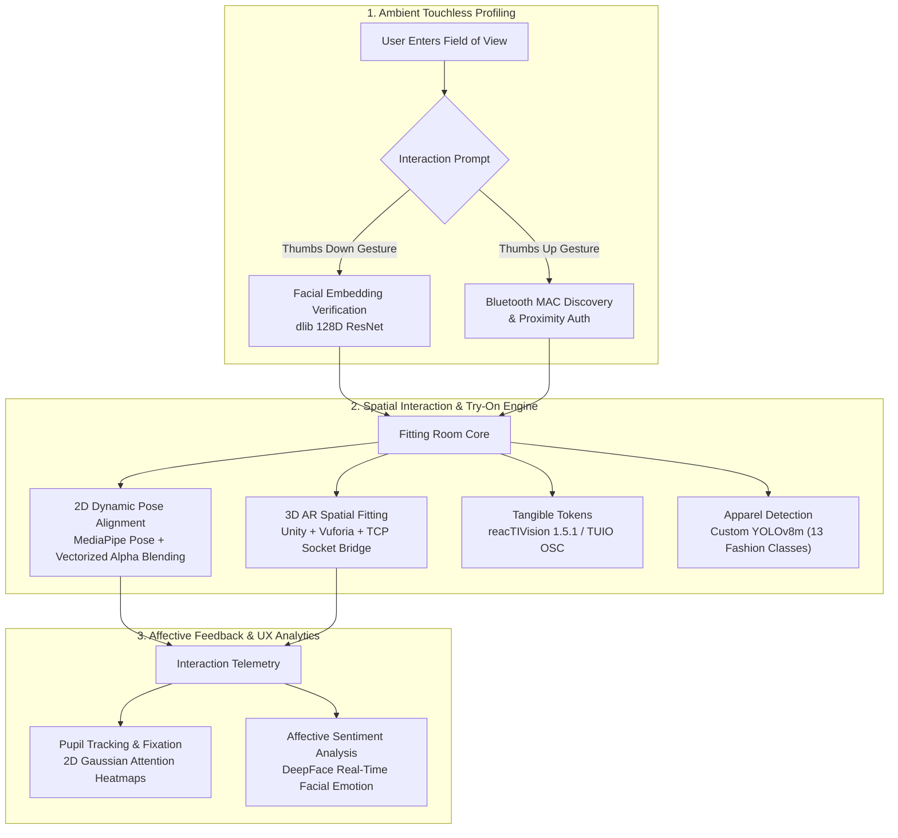

<div align="center">

# 🪞 Virtual Fitting Room (VFR): An HCI Exploration Testbed
### Multi-Modal Spatial Interaction • Tangible Tokens • Affective Feedback • Augmented Reality

[](https://www.python.org/)
[](https://developers.google.com/mediapipe)
[](https://github.com/ultralytics/ultralytics)
[](https://unity.com/)
[](#-hci-exploration-frontiers--future-work)
[](#-license)

<p align="center">
  An open-ended Human-Computer Interaction (HCI) laboratory and prototyping testbed investigating natural user interfaces (NUI), tangible user interfaces (TUI), and affective closed-loop evaluation for the future of digital retail and spatial computing.
</p>

[Key Findings](#-empirical-hci-findings-tui-vs-vision) •
[Architecture](#-system-architecture) •
[Quickstart](#-quickstart--installation) •
[Repository Layout](#-repository-structure) •
[Future Work Roadmap](docs/FUTURE_WORK.md)

</div>

---

## 🔬 Research & Exploration Motivation

Traditional virtual fitting rooms often reduce the experience to a static 2D preview on a phone or laptop. This project treats virtual fitting as a **rich, multi-dimensional HCI problem**:
* How do users naturally authenticate and claim their profile without touching public hardware?
* How does physical interaction with **tangible fiducial tokens (TUIO)** compare to **touchless vision-based skeletal gestures (MediaPipe)**?
* Can we detect cognitive load, hesitation, and satisfaction directly from **eye gaze fixations** and **micro-expressions** during the shopping journey?
* How can edge deep learning (YOLOv8) and 3D Augmented Reality (Unity + Vuforia) merge into a zero-latency spatial interface?

Originally seeded through human-computer interaction research at **MSA University** (Faculty of Computer Science, Giza, Egypt), this repository serves as an **exploratory codebase** to test, challenge, and invent new paradigms in spatial retail interaction.

---

## 📊 Empirical HCI Findings: TUI vs. Vision

In our controlled user evaluation benchmark (detailed in [`docs/Virtual Fitting Room Evaluation Report.docx`](docs/Virtual%20Fitting%20Room%20Evaluation%20Report.docx)), participants completed identical garment selection tasks across two modalities:

| Evaluation Dimension | Tangible UI (TUIO Markers) | Vision Gestures (MediaPipe Pose) | HCI Insight |
| :--- | :---: | :---: | :--- |
| **Average Task Completion Time** | **15.22 seconds** ⚡ | **47.84 seconds** | TUI was **~3x faster** due to direct physical feedback. |
| **System Ranking** | **Rank 1 (Preferred)** | **Rank 2** | Users gravitated toward physical tactile affordances. |
| **Ergonomic Strain** | Negligible | Moderate to High | Prolonged mid-air arm extension caused *"Gorilla Arm"* fatigue. |
| **Cognitive Load** | Low | Moderate | Gesture syntax (swipes, thumbs up/down, stop) required memorization. |
| **Primary Limitation** | Marker rotation jitter | Latency sensitivity & lack of haptic boundaries |

> 💡 **Core Exploration Question**: *How can we design hybrid interfaces that retain the touchless freedom of computer vision without suffering from ergonomic fatigue and memorization penalties?* See [Future Work](docs/FUTURE_WORK.md) for our active experiments.

---

## 🏗 System Architecture

The testbed connects sensing pipelines across biometrics, spatial pose estimation, deep learning garment classification, and 3D rendering engines:



---

## 🧩 Key Modules & Features

### 1. Hands-Free Authentication (`YOLO/main2.py`, `YOLO/BT2.py`, `YOLO/detect.py`)
* **Gesture-Driven Menu**: Users trigger authentication paths with intuitive hand poses (Thumbs Up = Bluetooth, Thumbs Down = Facial Recognition, Open Palm = Confirm).
* **Bluetooth MAC Discovery**: Scans local Bluetooth devices, allowing shoppers to select their device via hand gestures without touching a screen.
* **Facial Recognition**: Matches live webcam frames against registered user profiles with automated enrollment fallback.

### 2. High-Performance 2D Pose Try-On (`YOLO/Mediapipe.py`)
* **Dynamic Scaling**: Evaluates bi-acromial shoulder breadth (`LEFT_SHOULDER` to `RIGHT_SHOULDER`) to dynamically scale and drape 2D garments in real time.
* **$1 Unistroke Gesture Navigation**: Uses `dollarpy` to track right-wrist stroke paths:
  * **Swipe Left**: Cycles clothing categories (Shirts ➔ Hoodies ➔ Long Sleeves).
  * **Swipe Right**: Cycles through color variants and patterns.
* **Vectorized NumPy Blending**: Custom ROI matrix blending operating in sub-millisecond execution time (sustaining 30–60 FPS).

### 3. 3D Augmented Reality Bridge (`unity_ar/`, `AR.zip`)
* **TCP Socket Bridge (`switching.py`)**: Streams MediaPipe hand landmarks and wrist coordinates over a local TCP server (`localhost:5000`).
* **Unity AR Controller (`GestureSwitch.cs`)**: C# script running inside Unity with Vuforia Engine. Receives live wrist vectors to apply real-time 3D rotation and swap 3D apparel models.

### 4. Custom Fashion Detection (`YOLO/Versions/best.pt`, `fashion-clothes-detection-using-yolov8.ipynb`)
* **YOLOv8 Medium**: Fine-tuned on a 10,000-image annotated fashion dataset across **13 garment categories** (shirts, outwear, dresses, trousers, skirts, etc.).

### 5. Eye Gaze & Affective Evaluation (`YOLO/GazeTracking/`, `YOLO/emotions.py`)
* **Pupil Coordinate Tracking**: Localizes eye pupils and generates 2D Gaussian smoothed attention heatmaps overlaid on the user screen.
* **DeepFace Emotion Analytics**: Logs real-time user emotional state distribution to gauge delight, confusion, or frustration.

---

## ⚡ Recent Engineering & Optimization Highlights

In this release, the codebase underwent major cleanup and optimization:
1. **Vectorized Alpha Blending**: Replaced the legacy $O(H \times W)$ nested Python pixel loops in `Mediapipe.py` with vectorized NumPy array slicing. Rendering latency dropped by **>95%**, boosting real-time throughput from 2 FPS to 45+ FPS.
2. **Single-Pass Inference**: Eliminated duplicate `pose.process()` calls that previously ran twice per video frame.
3. **Fixed Gesture Logic**: Resolved an indentation bug in `Mediapipe.py` where variant switching (`switch += 1`) was unreachable.
4. **Adaptive Camera Fallback**: Added auto-detection logic across all scripts (`VideoCapture(0)` ➔ `VideoCapture(1)`) to eliminate crashes on single-webcam systems.
5. **Biometric Data Sanitation**: Corrected malformed entries in `registered_users.txt` and sandboxed temporary face captures.
6. **Extracted AR Integration**: Decompressed and organized the Unity C# and Python socket bridge scripts into `unity_ar/` for instant browsing and modification.

---

## 📂 Repository Structure

```text
Virtual-Fitting-Room/
├── README.md                                  # You are here
├── requirements.txt                           # Unified Python dependencies
├── .gitignore                                 # Git ignore rules (cache, virtualenvs, OS artifacts)
│
├── docs/                                      # Research & Academic Documentation
│   ├── FUTURE_WORK.md                         # Detailed HCI exploration roadmap & research questions
│   ├── HCI_PAPER.pdf                          # MSA University published research paper
│   ├── Virtual Fitting Room Evaluation Report.docx # Experimental evaluation benchmark report
│   ├── PACT.docx                              # HCI Framework analysis (People, Activity, Context, Technology)
│   └── Scenario.docx                          # User interaction scenarios & personas
│
├── YOLO/                                      # Core Python Computer Vision & Try-On Pipeline
│   ├── main2.py                               # Multi-modal entry point (Gesture menu ➔ Auth ➔ Fitting)
│   ├── Mediapipe.py                           # 2D garment overlay with $1 dollarpy gestures (Optimized)
│   ├── Yolo.py                                # YOLOv8 clothing detector & mode switcher
│   ├── detect.py                              # Face recognition login module
│   ├── functions.py                           # Camera & biometric enrollment utilities
│   ├── save.py                                # Face registration helper
│   ├── BT2.py                                 # Bluetooth MAC discovery & gesture-driven device selector
│   ├── emotions.py                            # Standalone DeepFace emotion analyzer
│   ├── registered_users.txt                   # Authorized Bluetooth device registry
│   ├── Versions/
│   │   └── best.pt                            # Trained YOLOv8m fashion weights (52 MB)
│   ├── clothes/                               # 2D Transparent garment templates
│   │   ├── shirt/                             # T-shirt variants (black, blue, green, red, white)
│   │   ├── hoodies/                           # Hoodie variants (blue, green, yellow)
│   │   ├── sleeves/                           # Long sleeve variants (black, white)
│   │   └── pants/                             # Pants variants (beige, brown)
│   ├── user_faces/                            # Registered face embeddings directory
│   └── GazeTracking/                          # Eye gaze tracking & attention heatmap generation
│       ├── example.py                         # Gaze & emotion tracking launcher
│       ├── gaze_tracking/                     # Pupil detection & calibration library
│       └── gaze_heatmap_with_screenshot.png   # Sample gaze heatmap
│
├── unity_ar/                                  # 3D Augmented Reality Interface
│   ├── switching.py                           # Python TCP socket server streaming landmarks
│   └── GestureSwitch.cs                       # Unity C# TCP client & 3D rotation handler
│
├── HEATMAP People/                            # Evaluation attention heatmaps (Ali, Essam, Hamza, etc.)
├── TESTS/                                     # Evaluation test session captures & screenshots
├── fashion-clothes-detection-using-yolov8(1).ipynb # Kaggle YOLOv8 training notebook
├── AR.zip                                     # Full Unity project archive with Vuforia assets
└── Markers latest.rar                         # reacTIVision 1.5.1 TUIO markers archive
```

---

## 🚀 Quickstart & Installation

### 1. Prerequisites
* **Operating System**: Windows 10/11, Linux, or macOS.
* **Python**: 3.10 or 3.11 recommended.
* **Camera**: Standard USB webcam or built-in laptop camera.
* **Optional**: Bluetooth adapter (for Bluetooth proximity login).

### 2. Environment Setup
Clone the repository and install dependencies:
```bash
# Clone the repository
git clone https://github.com/your-username/virtual-fitting-room.git
cd virtual-fitting-room

# Create and activate a virtual environment
python -m venv venv
# Windows:
venv\Scripts\activate
# Linux/macOS:
source venv/bin/activate

# Install required dependencies
pip install -r requirements.txt
```

> **Note on dlib**: On Windows, `dlib` requires CMake and Visual Studio C++ Build Tools. Pre-built wheels can also be installed using `pip install cmake` prior to installing `face-recognition`.

### 3. Launching the System

#### A. Full Multi-Modal Flow (Auth ➔ Try-On)
```bash
cd YOLO
python main2.py
```
* **Step 1**: Make a **Thumbs Up** (Bluetooth) or **Thumbs Down** (Face Recognition) gesture.
* **Step 2**: Make an **Open Palm ("Stop")** gesture to confirm your selection.
* **Step 3**: Once authenticated, the system transitions into the virtual fitting room.

#### B. Direct 2D Virtual Fitting Room Test
To jump directly into the real-time garment overlay without authentication:
```bash
cd YOLO
python Mediapipe.py
```
* **Swipe Left with right wrist**: Cycle clothing category (*Shirts ➔ Hoodies ➔ Long Sleeves*).
* **Swipe Right with right wrist**: Cycle colors/variants.
* Press `Esc` to exit.

#### C. Gaze & Affective Tracking Test
```bash
cd YOLO/GazeTracking
python example.py
```
* Tracks pupil fixations, records coordinates to CSV, estimates real-time emotion via DeepFace, and outputs a smoothed attention heatmap upon exit.

#### D. 3D Unity AR Bridge
1. Open the Unity project inside `AR.zip` with Unity 2022.3+ and ensure Vuforia Engine is installed.
2. Run the socket server:
   ```bash
   python unity_ar/switching.py
   ```
3. Press **Play** in Unity. Raise 4 fingers to switch 3D models or move your wrist to rotate the garment in 3D space.

---

## 🔮 HCI Exploration Frontiers & Future Work

We are actively exploring and welcoming experiments in the following directions:

1. **Gaze-Pinch Spatial Targeting**: Moving away from sustained mid-air waving to solve *"Gorilla Arm syndrome"* by combining foveal eye gaze for targeting with subtle waist-level micro-pinches.
2. **Diffusion & 3D Gaussian Splatting Try-On**: Transitioning from planar 2D affine warps to real-time generative latent diffusion (IDM-VTON) and 3D Gaussian Splatting for photorealistic fabric drape and tension.
3. **Affective Closed-Loop Adaptation**: Automatically adapting interface complexity and offering contextual style recommendations when hesitation or furrowed brows are detected.
4. **Hybrid Tangibles (TUI 2.0)**: Pairing physical fabric swatches (smart tokens with embedded NFC/ArUco markers) with AR projection mapping so users can physically feel fabric textures while viewing them in AR.

👉 **Read our comprehensive research roadmap in [`docs/FUTURE_WORK.md`](docs/FUTURE_WORK.md).**

---

## 👥 Authors & Academic Attribution

This exploration was originated as part of human-computer interaction coursework and research at **MSA University** (October University for Modern Sciences and Arts, Faculty of Computer Science, Giza, Egypt):
* **Hisham Ahmed Refaat**
* **Abdelrahman Ali**
* **Youssef Ahmed Hanafy**
* **Karim Emad Helmy**
* **Youssef Abdelhamid**
* **Mahmoud Ahmed**

### Citation
```bibtex
@article{msa_vfr_2024,
  title={Virtual Fitting Rooms: A Multi-Modal Comparative Study of Tangible and Vision-Based Interfaces},
  author={Refaat, Hisham Ahmed and Ali, Abdelrahman and Hanafy, Youssef Ahmed and Helmy, Karim Emad and Abdelhamid, Youssef and Ahmed, Mahmoud},
  institution={Faculty of Computer Science, MSA University},
  year={2024}
}
```

---

## 📄 License

This repository is distributed under the [MIT License](LICENSE). Third-party components (`reacTIVision`, `dollarpy`, `MediaPipe`, `YOLOv8`) remain subject to their respective upstream licenses.
