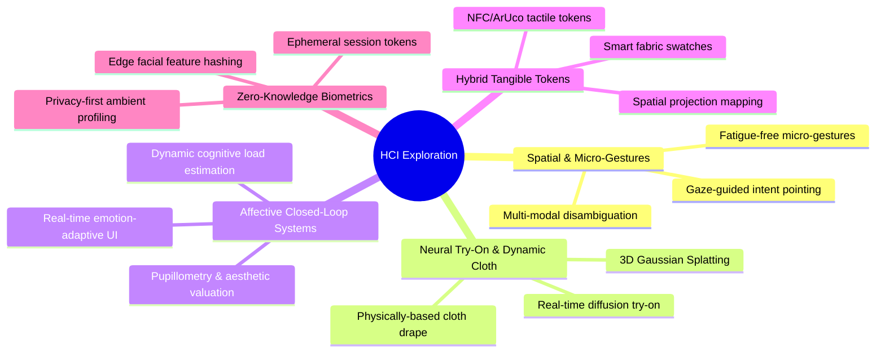

# HCI Research & Exploration Roadmap: Future Frontiers

> **Laboratory Notes & Exploration Trajectory**  
> *Investigating Next-Generation Spatial Interaction, Affective Closed-Loop Systems, and Tangible Augmented Reality in Smart Environments.*

---

## 1. Executive Research Motivation

Traditional retail interfaces rely heavily on indirect touchscreens or mouse-driven e-commerce portals. Virtual Fitting Rooms (VFRs) represent a high-stakes testbed for **Human-Computer Interaction (HCI)** because they demand real-time spatial awareness, low cognitive friction, natural body-centric ergonomics, and high user trust.

Our preliminary benchmarks revealed key tensions in the design space:
* **Tangible Interaction (TUIO)** achieved **~3x faster task completion (15.2s vs. 47.8s)** and zero physical strain, but required handling external physical artifacts.
* **Computer Vision Gestures (MediaPipe)** provided pure touchless immersion, but suffered from **physical fatigue (*Gorilla Arm syndrome*)**, gesture recall overhead, and latency sensitivity.

This exploration repository aims to bridge this gap through the following research horizons.

---

## 2. Research Horizons & Exploration Domains

---

## 3. Detailed Research Tracks

### Track A: Micro-Gestural Ergonomics & Gaze-Pinch Fusion
* **The Problem**: Sustained mid-air arm gestures (as evaluated in our first prototype) cause rapid trapezoidal and deltoid fatigue within 60–90 seconds (*"Gorilla Arm"*).
* **Exploratory Hypothesis**: Combining **subtle eye gaze for targeting** (foveal pointing) with **relaxed, waist-level finger pinches** (inspired by visionOS) will reduce task completion time to sub-10s while dropping physical fatigue scores to near zero.
* **Open Questions**:
  1. What is the optimal dwell-time threshold before gaze-directed targeting triggers visual feedback without causing the Midas Touch problem?
  2. Can MediaPipe hand landmarks accurately resolve micro-pinches when hands are kept low near the hips?

### Track B: Physics-Informed & Neural Virtual Try-On
* **The Problem**: 2D rigid image scaling (affine/perspective warp) fails to communicate drape, fabric thickness, stretch, and movement realism.
* **Exploratory Hypothesis**: Integrating lightweight Neural Radiance Fields (NeRF) or real-time 3D Gaussian Splatting (3DGS) with body mesh topology (SMPL-X / MediaPipe 3D Pose) allows realistic draping and light interaction at 60 FPS on edge hardware.
* **Exploration Steps**:
  * Experiment with ONNX-quantized latent diffusion models for virtual garment synthesis (e.g., real-time IDM-VTON distillations).
  * Implement spring-mass or position-based dynamics (PBD) mesh cloth simulation running in Unity/WebGL driven by MediaPipe 3D landmark velocity vectors.

### Track C: Affective Computing & Closed-Loop Adaptive Interfaces
* **The Problem**: Current retail systems are emotionally blind—they continue linear interaction regardless of whether the shopper is confused, frustrated, or delighted.
* **Exploratory Hypothesis**: Continuous monitoring of facial action units (via DeepFace / FACS) coupled with pupil diameter tracking enables a **bi-directional closed loop**:
  * **Frustration / Brow Furrow Detected**: System smoothly simplifies the UI, slows animation transitions, or presents high-confidence recommendations.
  * **Smile / Delight Detected**: System bookmarks the active outfit into a "Liked" basket and offers matching accessory suggestions.
* **Research Metrics**:
  * Correlation between gaze fixation duration on specific garment zones (collars, sleeves) and post-session purchase intent.
  * Pupil dilation response as an unconscious index of aesthetic preference.

### Track D: Hybrid Tangibles (TUI 2.0 & Smart Fabric Swatches)
* **The Problem**: Pure vision lacks tactile haptic affordances (users cannot "feel" the softness, warmth, or texture of the garment).
* **Exploratory Hypothesis**: Physical tangible swatches (embedded with fiducial ArUco tags or NFC chips) provide immediate tactile grounding. Touching a physical cashmere or denim puck instantly projects that material onto the user's digital avatar.
* **Prototypes to Build**:
  * 3D-printed dial rings with passive tactile detents.
  * Integration with WebTUIO and WebSerial for browser-based tangible computing.

### Track E: Privacy-Preserving Ambient Profiling
* **The Problem**: Storing raw webcam portraits (`user_faces/*.jpg`) and device MAC addresses creates severe biometric privacy risks under GDPR/CCPA.
* **Exploratory Hypothesis**: Biometric features should be encrypted at the sensor level, hashed into irreversible embeddings (e.g., cryptographic BioHash / Zero-Knowledge proofs), and verified locally without disk retention.

---

## 4. Proposed HCI Experimentation Protocol

When testing future iterations, employ the following standardized evaluation matrix:

| Metric | Target Goal | Measurement Instrument |
| :--- | :--- | :--- |
| **System Usability Scale (SUS)** | Score > 80 (Grade A) | 10-item standardized questionnaire |
| **Task Completion Time (TCT)** | < 12 seconds per garment swap | Timestamp logs |
| **NASA-TLX (Workload Index)** | Physical demand < 20 / 100 | Multi-dimensional subjective workload survey |
| **Gaze Dwell Efficiency** | Fixation-to-action ratio < 1.5 | Pupil tracking CSV analysis |
| **Affective Valence Shift** | Positive valence delta > +0.3 | DeepFace emotion delta (pre- vs. post-task) |

---

## 5. Get Involved & Contribute Ideas

If you are exploring novel human-computer interaction, spatial computing, or affective interfaces, feel free to open an **Issue** or submit a **Pull Request** proposing:
* Novel gesture grammars
* Better eye-tracking calibration heuristics
* Lightweight neural cloth models
* Ergonomic user study methodologies
